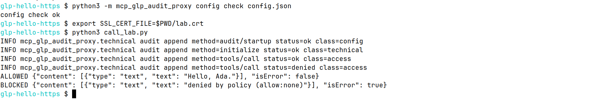

# First run: your keyboard, the proxy, and an HTTPS tool server

This page is a first run of the Community edition when the tool server is a TLS web address rather than a program the proxy starts. You install the package from PyPI, answer a short setup, start a tiny HTTPS server on your own computer, call one tool that is allowed, call one tool that is blocked, read the log, and check that the log still links.

You do not need to know Python. You paste three small programs and type the commands below. Do [the stdio page](stdio-to-proxy-to-stdio.md) first if you have not installed Python yet. This page repeats the install so it can be followed on its own.

The pictures are photographs of a Linux terminal after the commands were run. They are not drawings. On Windows the words are the same. The prompt ends with `>` instead of `$`. One picture below was taken in the stdio folder. Its caption says so. The words you compare are the help text and the setup answers, which are the same here.

The proxy speaks TLS 1.3 and reads one JSON object from the response. It does not read an SSE event stream. `http://` is refused. The address in this page is `https://127.0.0.1:8443/mcp`, which is a server you start yourself, on this computer only.

Community stores the log as one JSONL file in a folder you choose, plus a one-line `.head` file next to it. There is no database in this run. SQL storage is available in Pro.

## Prerequisites

You need:

- Windows 10 or 11, macOS, or Linux
- Python 3.11, 3.12, or 3.13
- OpenSSL, so you can make a one-day certificate for `127.0.0.1`
- A network connection for the install step

Step 1. Open a terminal and leave it open. This page uses a second terminal later, for the HTTPS server. The commands go in the first terminal until that step says otherwise.

- Linux: open Terminal. On Ubuntu, press Ctrl+Alt+T.
- macOS: open Spotlight (Command+Space), type Terminal, and press Return.
- Windows: open the Start menu, type `cmd`, and open Command Prompt. Use Command Prompt for this page. PowerShell is called out on the one line that differs.

Step 2. Ask Python for its version.

Linux or macOS:

```bash
python3 --version
```

Windows Command Prompt or PowerShell:

```bash
py -3 --version
```

You should see a line like `Python 3.12.3`. The third number can differ. The first two numbers must be 3.11, 3.12, or 3.13. If Python is missing or too old, install it the way [the stdio page](stdio-to-proxy-to-stdio.md) describes in its step 3, then open a new terminal and repeat this step.

Step 3. Check OpenSSL.

Linux, macOS, or Windows Command Prompt:

```bash
openssl version
```

You should see a line that starts with `OpenSSL`. On this machine it was `OpenSSL 3.0.13 30 Jan 2024 (Library: OpenSSL 3.0.13 30 Jan 2024)`. The date on your machine will differ.

Linux and macOS usually already have this command. On Windows, if you see `not recognized`, install Git for Windows from `https://git-scm.com/download/win`, open a new Command Prompt, and run `openssl version` again. If you still do not have OpenSSL, stop this page and do the stdio page. That page does not need a certificate.

Step 4. Make a folder for this run and go into it.

Linux or macOS:

```bash
mkdir -p "$HOME/glp-hello-https"
cd "$HOME/glp-hello-https"
pwd
```

Windows Command Prompt:

```bash
mkdir %USERPROFILE%\glp-hello-https
cd /d %USERPROFILE%\glp-hello-https
cd
```

You should see one line that ends with `glp-hello-https`. If `mkdir` says the folder already exists, continue with `cd`.

## Install

Step 5. Install the package from PyPI if you did not do that on the stdio page.

Linux or macOS:

```bash
python3 -m pip install mcp-glp-audit-proxy
```

Windows:

```bash
py -3 -m pip install mcp-glp-audit-proxy
```

A new install ends with a line that contains `Successfully installed` and `mcp-glp-audit-proxy-0.3.2`. If it is already installed, the line says `Requirement already satisfied`.

Then print the version.

Linux or macOS:

```bash
python3 -m pip show mcp-glp-audit-proxy
```

Windows:

```bash
py -3 -m pip show mcp-glp-audit-proxy
```

`Version:` should be `0.3.2`. If it is older, run the install again with `--upgrade` before the package name.

Step 6. Read the help.

Linux or macOS:

```bash
python3 -m mcp_glp_audit_proxy --help
```

Windows:

```bash
py -3 -m mcp_glp_audit_proxy --help
```

You should see:

```text
usage: mcp-glp-audit-proxy [-h] [--config CONFIG]

options:
  -h, --help       show this help message and exit
  --config CONFIG  Path to the JSON config file
```

There is no listen address. The proxy does not open a socket. The HTTPS address in the config is the target the proxy calls, not a port the proxy listens on.


This picture was taken in the stdio folder. Your prompt should end with `glp-hello-https`. The help text is the same.

## Minimal config

Step 7. Make a certificate the proxy will trust for this sample. Stay in the `glp-hello-https` folder. The command is the same on Linux, macOS, and Windows.

```bash
openssl req -x509 -newkey rsa:2048 -keyout lab.key -out lab.crt -days 2 -nodes -subj "/CN=127.0.0.1" -addext "subjectAltName=IP:127.0.0.1"
```

OpenSSL prints several lines of dots and plus signs while it makes the key. That is normal. When it finishes, the prompt comes back.

Check the two files.

Linux or macOS:

```bash
ls lab.crt lab.key
```

Windows:

```bash
dir lab.crt lab.key
```

You should see both names, `lab.crt` and `lab.key`. `lab.crt` is the certificate. `lab.key` is the private key. Leave both in this folder. Do not send `lab.key` to anyone. It exists only for this sample, and it expires in two days.

Step 8. Run the setup questions. Press Enter after each answer. On the last three questions, press Enter without typing.

Linux or macOS:

```bash
python3 -m mcp_glp_audit_proxy init config.json
```

Windows:

```bash
py -3 -m mcp_glp_audit_proxy init config.json
```

Type these answers when asked:

1. `./data/audit.jsonl`
2. `lab__hello`
3. `operator-1`
4. `Ada Analyst`
5. Enter (keeps `operator`)
6. Enter (keeps `swiss_glp`)
7. Enter (keeps `no`)

You should see `wrote config.json` as the last line. The full question text is the same as the stdio page.


This picture was taken in the stdio folder. The questions and `wrote config.json` are the same here. Your prompt should say `glp-hello-https`.

Step 9. Replace all of `config.json` with this file and save it in the `glp-hello-https` folder. Use the same editor rules as a plain-text save (on Windows, Notepad's "Save as type" must be All files so the name is not `config.json.txt`).

```json proxy
{
  "audit": {
    "path": "./data/audit.jsonl"
  },
  "policy": {
    "allow": ["lab__hello"],
    "deny": []
  },
  "principal": {
    "id": "operator-1",
    "name": "Ada Analyst",
    "role": "operator"
  },
  "retention": {
    "profile": "swiss_glp",
    "min_months": 6,
    "years_after_study": 10,
    "legal_hold": false
  },
  "upstreams": [
    {
      "name": "lab",
      "transport": "https",
      "protocol": "legacy",
      "url": "https://127.0.0.1:8443/mcp"
    }
  ]
}
```

What each field means:

- `audit.path` is the log file. `./data/audit.jsonl` means a file named `audit.jsonl` inside a folder named `data`, next to `config.json`. One JSON object is written per line. The `data` folder is created on the first call.
- `policy.allow` is the list of tool names this person may call. `lab__hello` is the `hello` tool on the server named `lab`. The two underscores join the server name and the tool name.
- `policy.deny` is a list of names that are always blocked, even if they also match `allow`. Empty means there is no extra block list. `lab__drop_all` is blocked because it is not in `allow`.
- `principal.id` is the short id on every log row. This page uses `operator-1`.
- `principal.name` is the person's name on the log. This page uses `Ada Analyst`.
- `principal.role` is what that person may do. `operator` may call tools. If this says `qa`, the hello call is blocked.
- `retention.profile` is a label for how long you plan to keep the log. `swiss_glp` means `years_after_study` years after the study, and at least `min_months` months. This edition does not delete the file for you.
- `retention.min_months` is that shortest keep time, in months.
- `retention.years_after_study` is how many years after the study you plan to keep the log.
- `retention.legal_hold` is `false` here, which means you are not marking the log as frozen. The file stays on disk either way in this edition.
- `upstreams` is the list of MCP servers the proxy will call. This page has one.
- `upstreams` `name` is the short server name. With `lab`, the hello tool is called `lab__hello`.
- `upstreams` `transport` is `https` here, which means the proxy connects to a web address that uses TLS. It does not start a program.
- `upstreams` `protocol` is `legacy`, which is the greeting the sample server speaks. Leave this word as it is.
- `upstreams` `url` is that address. It must start with `https://`. `127.0.0.1` means this computer. `8443` is the port the sample server uses. `/mcp` is the path.

There is no `command` field in this file. The proxy does not start the HTTPS server. You start it yourself in step 12.

Step 10. Check that the file loads.

Linux or macOS:

```bash
python3 -m mcp_glp_audit_proxy config check config.json
```

Windows:

```bash
py -3 -m mcp_glp_audit_proxy config check config.json
```

You should see:

```text
config check ok
```

## Hardened config

Step 11. You can skip this step and keep the file from step 9. The rest of the page works with that file. This file also names `lab__drop_all` in `deny`, and it sets `fail_closed` to `true`. `fail_closed` true means a call is refused when the log cannot be written. Save this over `config.json` only if you want that. Steps 12 onward still work. The same file is used on Windows, macOS, and Linux.

```json proxy
{
  "fail_closed": true,
  "audit": {
    "path": "./data/audit.jsonl"
  },
  "policy": {
    "allow": ["lab__hello"],
    "deny": ["lab__drop_all"]
  },
  "principal": {
    "id": "operator-1",
    "name": "Ada Analyst",
    "role": "operator"
  },
  "retention": {
    "profile": "swiss_glp",
    "min_months": 6,
    "years_after_study": 10,
    "legal_hold": false
  },
  "upstreams": [
    {
      "name": "lab",
      "transport": "https",
      "protocol": "legacy",
      "url": "https://127.0.0.1:8443/mcp"
    }
  ]
}
```

## Verification

Step 12. Create `https_lab.py` in the `glp-hello-https` folder. Paste the whole program and save it as plain text. This is the pretend HTTPS tool server. It has one tool, `hello`.

```python
"""HTTPS JSON-RPC MCP server for the hello-world guide. TLS 1.3. One tool: hello."""
from __future__ import annotations

import json
import ssl
from http.server import BaseHTTPRequestHandler, ThreadingHTTPServer


def handle(message: dict) -> dict | None:
    method = message.get("method")
    if "id" not in message:
        return None
    if method == "initialize":
        version = (message.get("params") or {}).get("protocolVersion")
        return {
            "jsonrpc": "2.0",
            "id": message.get("id"),
            "result": {
                "protocolVersion": version,
                "capabilities": {"tools": {}},
                "serverInfo": {"name": "hello-lab", "version": "0"},
            },
        }
    if method == "tools/list":
        return {
            "jsonrpc": "2.0",
            "id": message.get("id"),
            "result": {"tools": [_hello_tool()]},
        }
    if method == "tools/call":
        params = message.get("params") or {}
        if params.get("name") != "hello":
            return {
                "jsonrpc": "2.0",
                "id": message.get("id"),
                "error": {"code": -32602, "message": "unknown tool"},
            }
        who = (params.get("arguments") or {}).get("name")
        text = "Hello, %s." % who if isinstance(who, str) and who.strip() else "Hello."
        return {
            "jsonrpc": "2.0",
            "id": message.get("id"),
            "result": {"content": [{"type": "text", "text": text}], "isError": False},
        }
    return {
        "jsonrpc": "2.0",
        "id": message.get("id"),
        "error": {"code": -32601, "message": "method not found"},
    }


def _hello_tool() -> dict:
    return {
        "name": "hello",
        "description": "Say hello. Read only.",
        "inputSchema": {
            "type": "object",
            "properties": {"name": {"type": "string"}},
            "required": ["name"],
            "additionalProperties": False,
        },
    }


class Handler(BaseHTTPRequestHandler):
    def do_POST(self) -> None:
        length = int(self.headers.get("Content-Length") or "0")
        message = json.loads(self.rfile.read(length).decode("utf-8"))
        response = handle(message)
        if response is None:
            body = b"{}"
        else:
            body = json.dumps(response).encode("utf-8")
        self.send_response(200)
        self.send_header("Content-Type", "application/json")
        self.send_header("Content-Length", str(len(body)))
        self.end_headers()
        self.wfile.write(body)

    def log_message(self, fmt: str, *args: object) -> None:
        return


def main() -> None:
    context = ssl.SSLContext(ssl.PROTOCOL_TLS_SERVER)
    context.minimum_version = ssl.TLSVersion.TLSv1_3
    context.load_cert_chain("lab.crt", "lab.key")
    server = ThreadingHTTPServer(("127.0.0.1", 8443), Handler)
    server.socket = context.wrap_socket(server.socket, server_side=True)
    print("listening on https://127.0.0.1:8443/mcp", flush=True)
    server.serve_forever()


if __name__ == "__main__":
    main()
```

Step 13. Create `call_lab.py` in the same folder. This stands in for a desktop MCP client. It starts the proxy, calls `lab__hello` with the name Ada, then calls `lab__drop_all`. The proxy opens the HTTPS address. This program does not open it itself.

```python
"""One allowed tool call and one blocked tool call through the proxy."""
from __future__ import annotations

import json
import os
import subprocess
import sys


def main() -> None:
    env = {key: value for key, value in os.environ.items() if not key.startswith("GLP_")}
    proc = subprocess.Popen(
        [sys.executable, "-m", "mcp_glp_audit_proxy", "--config", "config.json"],
        stdin=subprocess.PIPE,
        stdout=subprocess.PIPE,
        text=True,
        env=env,
    )

    def rpc(message: dict) -> dict:
        assert proc.stdin is not None and proc.stdout is not None
        proc.stdin.write(json.dumps(message) + "\n")
        proc.stdin.flush()
        line = proc.stdout.readline()
        if not line:
            raise SystemExit("proxy closed stdout")
        return json.loads(line)

    rpc(
        {
            "jsonrpc": "2.0",
            "id": 1,
            "method": "initialize",
            "params": {
                "protocolVersion": "2025-11-25",
                "capabilities": {},
                "clientInfo": {"name": "hello-world", "version": "0"},
            },
        }
    )
    allowed = rpc(
        {
            "jsonrpc": "2.0",
            "id": 2,
            "method": "tools/call",
            "params": {"name": "lab__hello", "arguments": {"name": "Ada"}},
        }
    )
    blocked = rpc(
        {
            "jsonrpc": "2.0",
            "id": 3,
            "method": "tools/call",
            "params": {"name": "lab__drop_all", "arguments": {}},
        }
    )
    print("ALLOWED", json.dumps(allowed["result"]))
    print("BLOCKED", json.dumps(blocked["result"]))
    proc.stdin.close()
    proc.wait(timeout=8)


if __name__ == "__main__":
    main()
```

Step 14. Create `view_log.py` in the same folder.

```python
"""Print method, tool, and status from data/audit.jsonl."""
from __future__ import annotations

import json
from pathlib import Path


def main() -> None:
    path = Path("data/audit.jsonl")
    for line in path.read_text(encoding="utf-8").splitlines():
        if not line.strip():
            continue
        row = json.loads(line)
        print(row.get("method"), row.get("tool"), row.get("status"))


if __name__ == "__main__":
    main()
```

Step 15. Open a second terminal. Go into the same folder.

Linux or macOS, in the second terminal:

```bash
cd "$HOME/glp-hello-https"
python3 https_lab.py
```

Windows, in the second Command Prompt:

```bash
cd /d %USERPROFILE%\glp-hello-https
py -3 https_lab.py
```

You should see one line, and no prompt after it:

```text
listening on https://127.0.0.1:8443/mcp
```

Leave that terminal alone. The server is running. If you see `Address already in use`, an old copy is still running. Click that old window and press Ctrl+C, then run this step again.

Step 16. Go back to the first terminal. Tell Python to trust `lab.crt`, then make the two calls. The certificate variable has to be set in this same terminal. A new terminal does not keep it.

Linux or macOS:

```bash
export SSL_CERT_FILE="$PWD/lab.crt"
python3 call_lab.py
```

Windows Command Prompt:

```bash
set SSL_CERT_FILE=%CD%\lab.crt
py -3 call_lab.py
```

Windows PowerShell, if that is the window you have open:

```bash
$env:SSL_CERT_FILE = Join-Path (Get-Location) lab.crt
py -3 call_lab.py
```

You should see four `INFO` lines, then:

```text
ALLOWED {"content": [{"type": "text", "text": "Hello, Ada."}], "isError": false}
BLOCKED {"content": [{"type": "text", "text": "denied by policy (allow:none)"}], "isError": true}
```

`Hello, Ada.` means the allowed tool ran over TLS. `denied by policy (allow:none)` means `lab__drop_all` was blocked because that name is not on the allow list. The second terminal stays on the listening line. It does not print these lines.



The top of the picture is step 10. The middle is the certificate variable. The bottom is this step. The listening server is a different terminal and is not in the picture.

Step 17. Read the log, in the first terminal.

Linux or macOS:

```bash
python3 view_log.py
```

Windows:

```bash
py -3 view_log.py
```

You should see:

```text
audit/startup None ok
initialize None ok
tools/call lab__hello ok
tools/call lab__drop_all denied
```

`None` means that row is not a tool call.

Step 18. Check that the log rows still link.

Linux or macOS:

```bash
python3 -m mcp_glp_audit_proxy verify data/audit.jsonl --print-head
```

Windows:

```bash
py -3 -m mcp_glp_audit_proxy verify data/audit.jsonl --print-head
```

You should see four `seq=` rows, then a `chain ok entries=4` line, then `seq=4 entry_hash=` and the same 64 hex characters as `head=`. The times and the hex differ every run. `tool=-` on the first two rows means those rows are not tool calls. Row 3 is `tool=lab__hello` and `status=ok`. Row 4 is `tool=lab__drop_all` and `status=denied`. One real run of the stdio page is shown here so you can see the shape. Your https run uses the same four rows and a different time and hex:


That picture is the stdio run. The https run prints the same kind of lines.

Step 19. Stop the sample server. Click the second terminal and press Ctrl+C. The prompt comes back. You can close that window.

## Pitfalls

- The HTTPS address belongs in the proxy config. Do not also register it in the desktop app. Calls that skip the proxy are not in this log.
- `http://127.0.0.1:8443/mcp` is refused. The scheme has to be `https://`.
- The sample certificate expires in two days. If a later run says the certificate is expired, repeat step 7.
- Do not edit `data/audit.jsonl`. Step 18 will then fail.
- This edition writes a JSONL file in a folder. SQL storage is available in Pro.

## If it doesn't work

Work down this list. The first terminal should be in the `glp-hello-https` folder.

1. Step 2 says Python is missing. Use the install notes on the stdio page, then open a new terminal. On Windows the command is `py -3`, not `python3`.
2. Step 3 says `openssl` is not recognized. Install Git for Windows, open a new Command Prompt, and try again. If you cannot, use the stdio page.
3. Step 5 says `externally-managed-environment`. Add `--user` before the package name and run the install again.
4. Step 10 does not say `config check ok`. Compare `config.json` with the box in step 9. The url has to start with `https://`.
5. Step 15 says `Address already in use`. Press Ctrl+C in the terminal that is already running `https_lab.py`, then start it once.
6. Step 15 says it cannot find `lab.crt` or `lab.key`. You are not in the `glp-hello-https` folder, or step 7 did not finish. Run `pwd` or `cd` and confirm the folder, then repeat step 7.
7. Step 16 says `proxy closed stdout`, `certificate verify failed`, or a TLS error. Set `SSL_CERT_FILE` again in that same terminal, using the command in step 16, then run `call_lab.py` again. The second terminal must still show the listening line.
8. Step 16 says connection refused. The second terminal is not running, or it printed an error instead of the listening line. Start step 15 again and wait for that line before step 16.
9. Both result lines say `denied`. `policy.allow` is not `lab__hello`, or the role is not `operator`. Close the first terminal, open a new one, go back into the folder, set `SSL_CERT_FILE` again, and rerun step 16.
10. Step 18 does not print `chain ok`. The path is `data/audit.jsonl` next to `config.json`. If you edited that file, delete the `data` folder, rerun step 16, then step 18.
