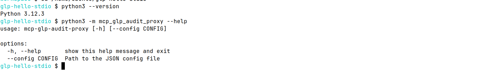
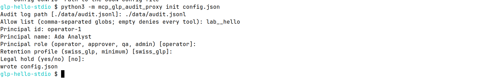
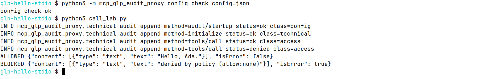
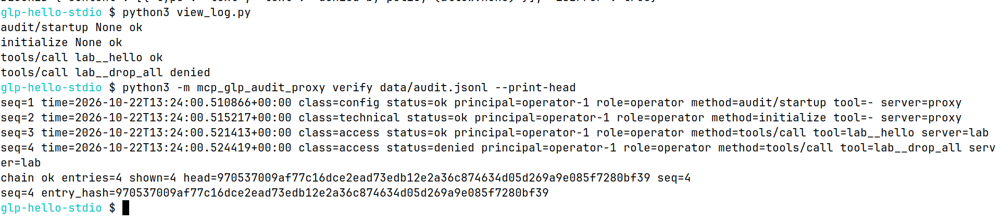

# First run: your keyboard, the proxy, and a program on this computer

This page is a first run of the Community edition. You install the package from PyPI, answer a short setup, call one tool that is allowed, call one tool that is blocked, read the log, and check that the log still links. You do not need to know Python. You paste three small programs and type the commands below.

The client in this run is a small program you start yourself. The target is another small program on the same computer. A desktop app such as Cursor or Claude Desktop is the same kind of client: it starts the proxy and talks to it on the proxy's standard input. Those apps are covered in the other manuals. This page does not ask you to change them.

The pictures are photographs of a Linux terminal after the commands were run. They are not drawings. On Windows the words are the same. The prompt ends with `>` instead of `$`, and the folder at the start of the prompt is yours.

Community stores the log as one JSONL file in a folder you choose, plus a one-line `.head` file next to it. There is no database in this run. SQL storage is available in Pro.

## Prerequisites

You need:

- Windows 10 or 11, macOS, or Linux
- Python 3.11, 3.12, or 3.13
- A network connection for the install step

Step 1. Open a terminal and leave it open. Every command on this page is typed there, except the three programs, which you save in a text editor.

- Linux: open Terminal. On Ubuntu, press Ctrl+Alt+T.
- macOS: open Spotlight (Command+Space), type Terminal, and press Return.
- Windows: open the Start menu, type `cmd`, and open Command Prompt. Use Command Prompt for this page. The commands also work in PowerShell, and the https page calls out the one line that differs.

Step 2. Ask Python for its version.

Linux or macOS:

```bash
python3 --version
```

Windows Command Prompt or PowerShell:

```bash
py -3 --version
```

You should see a line like `Python 3.12.3`. The third number can differ. The first two numbers must be 3.11, 3.12, or 3.13.

If you see `command not found`, `not recognized`, or a version below 3.11, do step 3. If the version is already 3.11 or newer, skip to step 4.

Step 3. Install Python, then close the terminal, open a new one, and repeat step 2.

- Windows: download the Windows installer for Python 3.12 from `https://www.python.org/downloads/windows/`. On the first screen, turn on "Add python.exe to PATH", then install. Open a new Command Prompt and run `py -3 --version` again.
- macOS: download the macOS installer for Python 3.12 from `https://www.python.org/downloads/macos/` and run it. Open a new Terminal and run `python3 --version` again.
- Debian or Ubuntu: in Terminal, run `sudo apt install python3 python3-pip`, enter your password if asked, then open a new Terminal and run `python3 --version` again. On other Linux systems, install Python 3.11 or newer with that system's package tool.

Step 4. Make a folder for this run and go into it. The later commands only work if the terminal is inside this folder.

Linux or macOS:

```bash
mkdir -p "$HOME/glp-hello-stdio"
cd "$HOME/glp-hello-stdio"
pwd
```

You should see one line that ends with `glp-hello-stdio`. If `mkdir` says the folder already exists, that is fine. `cd` still moves you into it.

Windows Command Prompt:

```bash
mkdir %USERPROFILE%\glp-hello-stdio
cd /d %USERPROFILE%\glp-hello-stdio
cd
```

You should see one line that ends with `glp-hello-stdio`. If `mkdir` says the folder already exists, continue with `cd`.

## Install

Step 5. Install the package from PyPI. This can take a minute. You only do it once per computer.

Linux or macOS:

```bash
python3 -m pip install mcp-glp-audit-proxy
```

Windows:

```bash
py -3 -m pip install mcp-glp-audit-proxy
```

A new install ends with a line that contains `Successfully installed` and `mcp-glp-audit-proxy`. If you already installed it, the line says `Requirement already satisfied`. Either line is fine.

Then print the installed version.

Linux or macOS:

```bash
python3 -m pip show mcp-glp-audit-proxy
```

Windows:

```bash
py -3 -m pip show mcp-glp-audit-proxy
```

You should see `Name: mcp-glp-audit-proxy` and a `Version:` line of `0.3.0` or newer. If the version is older than `0.3.0`, run the install command again with `--upgrade` before `mcp-glp-audit-proxy`:

Linux or macOS:

```bash
python3 -m pip install --upgrade mcp-glp-audit-proxy
```

Windows:

```bash
py -3 -m pip install --upgrade mcp-glp-audit-proxy
```

Step 6. Read the help. This shows the only flag the program accepts.

Linux or macOS:

```bash
python3 -m mcp_glp_audit_proxy --help
```

Windows:

```bash
py -3 -m mcp_glp_audit_proxy --help
```

You should see:

```text
usage: mcp-glp-audit-proxy [-h] [--config CONFIG]

options:
  -h, --help       show this help message and exit
  --config CONFIG  Path to the JSON config file
```

There is no listen address and no port. The proxy does not open a socket. Your client starts it, and the client talks to it on standard input.



The picture is the Linux run of steps 4 and 6. Your home folder will differ. The help text will not.

## Minimal config

Step 7. Run the setup questions and type the answers below. Press Enter after each answer. On the last three questions, press Enter without typing, which keeps the value shown in brackets.

Linux or macOS:

```bash
python3 -m mcp_glp_audit_proxy init config.json
```

Windows:

```bash
py -3 -m mcp_glp_audit_proxy init config.json
```

Type these answers when asked:

1. `./data/audit.jsonl`
2. `lab__hello`
3. `operator-1`
4. `Ada Analyst`
5. Enter (keeps `operator`)
6. Enter (keeps `swiss_glp`)
7. Enter (keeps `no`)

You should see:

```text
Audit log path [./data/audit.jsonl]: ./data/audit.jsonl
Allow list (comma-separated globs; empty denies every tool): lab__hello
Principal id: operator-1
Principal name: Ada Analyst
Principal role (operator, approver, qa, admin) [operator]:
Retention profile (swiss_glp, minimum) [swiss_glp]:
Legal hold (yes/no) [no]:
wrote config.json
```

The last line, `wrote config.json`, means the file is in the folder you created in step 4.



Step 8. Open `config.json` in a text editor and replace the whole file with the box for your system. Save it in the same folder. This adds the sample program the proxy will start. The setup in step 7 does not ask about that program.

Windows: Notepad, File, Save As, the `glp-hello-stdio` folder, file name `config.json`, and "Save as type" set to All files so Notepad does not add `.txt`.

macOS: TextEdit in plain-text mode (Format, Make Plain Text). If the save dialog offers `.txt`, turn that off.

Linux or macOS file:

```json proxy
{
  "audit": {
    "path": "./data/audit.jsonl"
  },
  "policy": {
    "allow": ["lab__hello"],
    "deny": []
  },
  "principal": {
    "id": "operator-1",
    "name": "Ada Analyst",
    "role": "operator"
  },
  "retention": {
    "profile": "swiss_glp",
    "min_months": 6,
    "years_after_study": 10,
    "legal_hold": false
  },
  "upstreams": [
    {
      "name": "lab",
      "transport": "stdio",
      "protocol": "legacy",
      "command": "python3",
      "args": ["hello_server.py"]
    }
  ]
}
```

Windows file. The only difference is the program that starts the sample server:

```json proxy
{
  "audit": {
    "path": "./data/audit.jsonl"
  },
  "policy": {
    "allow": ["lab__hello"],
    "deny": []
  },
  "principal": {
    "id": "operator-1",
    "name": "Ada Analyst",
    "role": "operator"
  },
  "retention": {
    "profile": "swiss_glp",
    "min_months": 6,
    "years_after_study": 10,
    "legal_hold": false
  },
  "upstreams": [
    {
      "name": "lab",
      "transport": "stdio",
      "protocol": "legacy",
      "command": "py",
      "args": ["-3", "hello_server.py"]
    }
  ]
}
```

What each field means:

- `audit.path` is the log file. `./data/audit.jsonl` means a file named `audit.jsonl` inside a folder named `data`, next to `config.json`. One JSON object is written per line. The `data` folder is created on the first call. You do not create it yourself.
- `policy.allow` is the list of tool names this person may call. `lab__hello` is the `hello` tool on the server named `lab`. The two underscores are the join between the server name and the tool name. A trailing `*` would match many names. This page uses the one exact name.
- `policy.deny` is a list of names that are always blocked, even if they also match `allow`. An empty list means there is no extra block list. `lab__drop_all` is blocked because it is not in `allow`.
- `principal.id` is the short id written on every log row. This page uses `operator-1`.
- `principal.name` is the person's name written on the log. This page uses `Ada Analyst`.
- `principal.role` is what that person may do. `operator` may call tools. The other roles are `approver`, `qa`, and `admin`. If this says `qa`, the hello call is blocked.
- `retention.profile` is a label for how long you plan to keep the log. `swiss_glp` means `years_after_study` years after the study, and at least `min_months` months. This edition does not delete the file for you.
- `retention.min_months` is that shortest keep time, in months. `6` is six months.
- `retention.years_after_study` is how many years after the study you plan to keep the log. `10` is ten years.
- `retention.legal_hold` is `false` here, which means you are not marking the log as frozen. `true` means do not dispose of it yet. The file stays on disk either way in this edition.
- `upstreams` is the list of MCP servers the proxy will call. This page has one.
- `upstreams` `name` is the short server name. With `lab`, the hello tool is called `lab__hello`.
- `upstreams` `transport` is `stdio` here, which means the proxy starts a program on this computer and talks to that program on its standard input and output.
- `upstreams` `protocol` is `legacy`, which is the greeting the sample program speaks. Leave this word as it is for this page.
- `upstreams` `command` is the program to start. `python3` on Linux and macOS. `py` on Windows.
- `upstreams` `args` is the arguments to that program. On Windows the first argument is `-3`, then the script name.

Step 9. Check that the file loads. Stay in the same folder.

Linux or macOS:

```bash
python3 -m mcp_glp_audit_proxy config check config.json
```

Windows:

```bash
py -3 -m mcp_glp_audit_proxy config check config.json
```

You should see one line:

```text
config check ok
```

## Hardened config

Step 10. You can skip this step and keep the file from step 8. The rest of the page works with that file. This step is a tighter file: `lab__drop_all` is named in `deny` as well as being absent from `allow`, and `fail_closed` is `true`.

`fail_closed` set to `true` means a call is refused when the log cannot be written. Set to `false`, a log failure does not by itself stop the call. The file in step 8 leaves this at its default. This file sets it to `true`.

Save this over `config.json` only if you want the tighter file. Steps 11 onward still work.

Linux or macOS:

```json proxy
{
  "fail_closed": true,
  "audit": {
    "path": "./data/audit.jsonl"
  },
  "policy": {
    "allow": ["lab__hello"],
    "deny": ["lab__drop_all"]
  },
  "principal": {
    "id": "operator-1",
    "name": "Ada Analyst",
    "role": "operator"
  },
  "retention": {
    "profile": "swiss_glp",
    "min_months": 6,
    "years_after_study": 10,
    "legal_hold": false
  },
  "upstreams": [
    {
      "name": "lab",
      "transport": "stdio",
      "protocol": "legacy",
      "command": "python3",
      "args": ["hello_server.py"]
    }
  ]
}
```

Windows:

```json proxy
{
  "fail_closed": true,
  "audit": {
    "path": "./data/audit.jsonl"
  },
  "policy": {
    "allow": ["lab__hello"],
    "deny": ["lab__drop_all"]
  },
  "principal": {
    "id": "operator-1",
    "name": "Ada Analyst",
    "role": "operator"
  },
  "retention": {
    "profile": "swiss_glp",
    "min_months": 6,
    "years_after_study": 10,
    "legal_hold": false
  },
  "upstreams": [
    {
      "name": "lab",
      "transport": "stdio",
      "protocol": "legacy",
      "command": "py",
      "args": ["-3", "hello_server.py"]
    }
  ]
}
```

## Verification

Step 11. Create a file named `hello_server.py` in the `glp-hello-stdio` folder. Paste the whole program below and save. Do not change it. This is the pretend tool server. It has one tool, `hello`. It does not have `drop_all`. The proxy blocks `lab__drop_all` before this program sees it.

```python
"""Stdio MCP server for the hello-world guide. One tool: hello."""
from __future__ import annotations

import json
import sys


def main() -> None:
    for line in sys.stdin:
        if not line.strip():
            continue
        message = json.loads(line)
        response = handle(message)
        if response is None:
            continue
        sys.stdout.write(json.dumps(response, separators=(",", ":")) + "\n")
        sys.stdout.flush()


def handle(message: dict) -> dict | None:
    method = message.get("method")
    if "id" not in message:
        return None
    if method == "initialize":
        version = (message.get("params") or {}).get("protocolVersion")
        return {
            "jsonrpc": "2.0",
            "id": message.get("id"),
            "result": {
                "protocolVersion": version,
                "capabilities": {"tools": {}},
                "serverInfo": {"name": "hello-lab", "version": "0"},
            },
        }
    if method == "tools/list":
        return {
            "jsonrpc": "2.0",
            "id": message.get("id"),
            "result": {"tools": [_hello_tool()]},
        }
    if method == "tools/call":
        params = message.get("params") or {}
        if params.get("name") != "hello":
            return {
                "jsonrpc": "2.0",
                "id": message.get("id"),
                "error": {"code": -32602, "message": "unknown tool"},
            }
        who = (params.get("arguments") or {}).get("name")
        text = "Hello, %s." % who if isinstance(who, str) and who.strip() else "Hello."
        return {
            "jsonrpc": "2.0",
            "id": message.get("id"),
            "result": {"content": [{"type": "text", "text": text}], "isError": False},
        }
    return {
        "jsonrpc": "2.0",
        "id": message.get("id"),
        "error": {"code": -32601, "message": "method not found"},
    }


def _hello_tool() -> dict:
    return {
        "name": "hello",
        "description": "Say hello. Read only.",
        "inputSchema": {
            "type": "object",
            "properties": {"name": {"type": "string"}},
            "required": ["name"],
            "additionalProperties": False,
        },
    }


if __name__ == "__main__":
    main()
```

Check that the file is in the folder.

Linux or macOS:

```bash
ls hello_server.py
```

Windows:

```bash
dir hello_server.py
```

You should see the name `hello_server.py`. Do not run the file by itself. It waits for the proxy.

Step 12. Create `call_lab.py` in the same folder and paste this program. This stands in for a desktop MCP client. It starts the proxy, calls `lab__hello` with the name Ada, then calls `lab__drop_all`.

```python
"""One allowed tool call and one blocked tool call through the proxy."""
from __future__ import annotations

import json
import os
import subprocess
import sys


def main() -> None:
    env = {key: value for key, value in os.environ.items() if not key.startswith("GLP_")}
    proc = subprocess.Popen(
        [sys.executable, "-m", "mcp_glp_audit_proxy", "--config", "config.json"],
        stdin=subprocess.PIPE,
        stdout=subprocess.PIPE,
        text=True,
        env=env,
    )

    def rpc(message: dict) -> dict:
        assert proc.stdin is not None and proc.stdout is not None
        proc.stdin.write(json.dumps(message) + "\n")
        proc.stdin.flush()
        line = proc.stdout.readline()
        if not line:
            raise SystemExit("proxy closed stdout")
        return json.loads(line)

    rpc(
        {
            "jsonrpc": "2.0",
            "id": 1,
            "method": "initialize",
            "params": {
                "protocolVersion": "2025-11-25",
                "capabilities": {},
                "clientInfo": {"name": "hello-world", "version": "0"},
            },
        }
    )
    allowed = rpc(
        {
            "jsonrpc": "2.0",
            "id": 2,
            "method": "tools/call",
            "params": {"name": "lab__hello", "arguments": {"name": "Ada"}},
        }
    )
    blocked = rpc(
        {
            "jsonrpc": "2.0",
            "id": 3,
            "method": "tools/call",
            "params": {"name": "lab__drop_all", "arguments": {}},
        }
    )
    print("ALLOWED", json.dumps(allowed["result"]))
    print("BLOCKED", json.dumps(blocked["result"]))
    proc.stdin.close()
    proc.wait(timeout=8)


if __name__ == "__main__":
    main()
```

Linux or macOS:

```bash
ls call_lab.py
```

Windows:

```bash
dir call_lab.py
```

You should see the name `call_lab.py`.

Step 13. Create `view_log.py` in the same folder and paste this program. It prints three words from each log line: what happened, which tool, and whether it was allowed.

```python
"""Print method, tool, and status from data/audit.jsonl."""
from __future__ import annotations

import json
from pathlib import Path


def main() -> None:
    path = Path("data/audit.jsonl")
    for line in path.read_text(encoding="utf-8").splitlines():
        if not line.strip():
            continue
        row = json.loads(line)
        print(row.get("method"), row.get("tool"), row.get("status"))


if __name__ == "__main__":
    main()
```

Linux or macOS:

```bash
ls view_log.py
```

Windows:

```bash
dir view_log.py
```

You should see the name `view_log.py`.

Step 14. Make the two calls. Stay in the `glp-hello-stdio` folder.

Linux or macOS:

```bash
python3 call_lab.py
```

Windows:

```bash
py -3 call_lab.py
```

You should see four `INFO` lines, then one `ALLOWED` line, then one `BLOCKED` line. The `INFO` lines are the proxy saying it wrote the log. The two result lines are:

```text
ALLOWED {"content": [{"type": "text", "text": "Hello, Ada."}], "isError": false}
BLOCKED {"content": [{"type": "text", "text": "denied by policy (allow:none)"}], "isError": true}
```

`Hello, Ada.` means the allowed tool ran. `denied by policy (allow:none)` means `lab__drop_all` was blocked because that name is not on the allow list. `isError` true on the blocked line is the proxy refusing the call. It is the result this page is looking for.



The top of the picture is step 9. The bottom is step 14.

Step 15. Read the log.

Linux or macOS:

```bash
python3 view_log.py
```

Windows:

```bash
py -3 view_log.py
```

You should see:

```text
audit/startup None ok
initialize None ok
tools/call lab__hello ok
tools/call lab__drop_all denied
```

`None` means that row is not a tool call. `ok` on `lab__hello` matches the allowed call. `denied` on `lab__drop_all` matches the blocked call.

Step 16. Check that the log rows still link. `--print-head` prints the tip so you can copy it somewhere else. [Anchoring and verification](../anchoring-and-verification.md) explains that copy.

Linux or macOS:

```bash
python3 -m mcp_glp_audit_proxy verify data/audit.jsonl --print-head
```

Windows:

```bash
py -3 -m mcp_glp_audit_proxy verify data/audit.jsonl --print-head
```

A real run looks like this. Your times and the long hex string will differ. `chain ok`, the four methods, `lab__hello`, and `lab__drop_all` will not.

```text
seq=1 time=2026-10-22T13:24:00.510866+00:00 class=config status=ok principal=operator-1 role=operator method=audit/startup tool=- server=proxy
seq=2 time=2026-10-22T13:24:00.515217+00:00 class=technical status=ok principal=operator-1 role=operator method=initialize tool=- server=proxy
seq=3 time=2026-10-22T13:24:00.521413+00:00 class=access status=ok principal=operator-1 role=operator method=tools/call tool=lab__hello server=lab
seq=4 time=2026-10-22T13:24:00.524419+00:00 class=access status=denied principal=operator-1 role=operator method=tools/call tool=lab__drop_all server=lab
chain ok entries=4 shown=4 head=970537009af77c16dce2ead73edb12e2a36c874634d05d269a9e085f7280bf39 seq=4
seq=4 entry_hash=970537009af77c16dce2ead73edb12e2a36c874634d05d269a9e085f7280bf39
```

`tool=-` means that row is not a tool call. `chain ok entries=4` means the four rows still link. The hex after `head=` and the hex after `entry_hash=` are the same 64 characters. The command finishes and returns you to the prompt. That is a good run.



The top of the picture is step 15. The bottom is step 16. A long line may wrap on a narrow window. The words are still one row.

The log file is `data/audit.jsonl`. Next to it, `data/audit.jsonl.head` is the one-line tip. Leave both files as the program wrote them.

## Pitfalls

- Register the proxy with the desktop app, not the sample server. If the app can start `hello_server.py` itself, those calls are not in this log. The host shape is in [generic stdio](../generic-stdio.md).
- Do not edit `data/audit.jsonl` in a text editor. Step 16 will then fail.
- Do not point a second MCP server entry at `hello_server.py` beside the proxy.
- This edition writes a JSONL file in a folder. It does not open a database. SQL storage is available in Pro.

## If it doesn't work

Work down this list. Stay in the `glp-hello-stdio` folder while you retry.

1. Step 2 says Python is missing or too old. Do step 3, close the terminal, open a new one, and start again at step 2. On Windows the command is `py -3`, not `python3`.
2. Step 5 says `externally-managed-environment`. Add `--user` before the package name: `python3 -m pip install --user mcp-glp-audit-proxy` on Linux or macOS, or `py -3 -m pip install --user mcp-glp-audit-proxy` on Windows.
3. Step 9 does not say `config check ok`. You are in the wrong folder, or `config.json` is not the box from step 8. Open the file and compare it. A common Notepad mistake is a file named `config.json.txt`.
4. Step 14 says `proxy closed stdout` or exits before `ALLOWED`. `hello_server.py` is missing from this folder, or the Windows file still says `"command": "python3"`. Use the Windows box from step 8.
5. Both result lines say `denied`. `policy.allow` does not contain `lab__hello`, or `principal.role` is not `operator`. An old terminal can also have `GLP_PRINCIPAL_ROLE` set, which overrides the file. Close the terminal, open a new one, `cd` back into the folder, and run step 14 again.
6. The blocked line is missing and `drop_all` seems to run. `policy.allow` is wider than `lab__hello` (a trailing `*` matches more names). Put the allow list back to the one name.
7. Step 16 does not print `chain ok`. The path must be `data/audit.jsonl` next to `config.json`. If you changed that file by hand, delete the `data` folder and run step 14 again, then step 16.
8. Step 14 prints `Hello, Ada.` but step 15 cannot find the log. You ran the commands from a different folder than `config.json`. Run `pwd` (Linux or macOS) or `cd` (Windows) and confirm the line ends with `glp-hello-stdio`.
